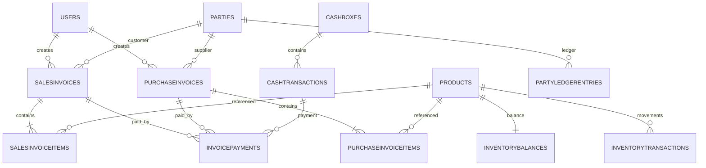

from pathlib import Path

content = r"""# Recommended Approval — تصميم قاعدة البيانات وعقود API المشتركة
**المشروع:** نظام محاسبي مصغر  
**الإصدار:** 1.0 — مسودة اعتماد فني  
**التاريخ:** 2026-11-17  
**الحالة:** مقترح موحد للمراجعة والاعتماد قبل بدء التنفيذ

> **الغرض:** توحيد تصميم قاعدة البيانات وعقود API بين أعضاء الفريق حتى تعمل الوحدات بصورة متوافقة. هذا المستند يحول متطلبات المشروع وسير العمل إلى تصميم تقني مقترح؛ ولا يعتبر أن القرارات التجارية المفتوحة قد حُسمت تلقائياً.

---

## 1. قرارات التصميم الأساسية

| البند | القرار المقترح |
|---|---|
| نمط النظام | تطبيق لمتجر واحد، دون دعم فروع متعددة في الإصدار الأول |
| Backend | ASP.NET Core Web API — C# |
| ORM | Entity Framework Core |
| قاعدة البيانات | Microsoft SQL Server |
| API | REST JSON، بإصدار `/api/v1` |
| Frontend | React + TypeScript |
| المعرفات | `uniqueidentifier` (UUID) للمفاتيح الأساسية |
| التوقيت | تخزين التواريخ الزمنية بصيغة UTC، وعرضها حسب إعداد التشغيل |
| اللغة | أسماء الحقول والـ API بالإنجليزية، والواجهة عربية RTL |
| الحذف | تعطيل/أرشفة البيانات المرجعية عند الحاجة؛ عدم حذف الحركات المالية أو المخزنية المعتمدة |
| المعاملات | اعتماد الفاتورة وآثارها المالية والمخزنية ضمن معاملة قاعدة بيانات واحدة |
| العملة والدقة | عملة واحدة للمتجر؛ قيمة العملة والدقة وسياسة التقريب تحتاج اعتماداً قبل الإطلاق |

### 1.1 مبادئ لا يجوز كسرها
1. المسودة لا تؤثر في المخزون أو الصندوق أو أرصدة العملاء والموردين.
2. فاتورة البيع المعتمدة تخفض المخزون، وفاتورة الشراء المعتمدة تزيده.
3. الصندوق يتغير بالمبلغ المقبوض أو المدفوع فعلياً فقط، وليس بإجمالي الفاتورة الآجلة.
4. المتبقي = إجمالي الفاتورة − مجموع الدفعات/المقبوضات المرتبطة بها.
5. يمنع المخزون السالب افتراضياً.
6. لا تقبل حركة مالية بقيمة صفرية أو سالبة.
7. لا تتجاوز الدفعات المبلغ المستحق إلا إذا اعتمدت سياسة الرصيد الدائن.
8. لا تحذف الحركة المعتمدة نهائياً؛ يتم عكسها بسبب وصلاحية مع الاحتفاظ بالأصل.
9. يجب أن ترتبط حركة المخزون والصندوق والطرف بمصدر العملية الأصلي.
10. لا تدخل المرتجعات في الإصدار الأول قبل اعتماد قواعدها.

---

## 2. تصميم قاعدة البيانات المقترح

### 2.1 اصطلاحات عامة
- كل جدول يحتوي `Id uniqueidentifier` كمفتاح أساسي.
- حقول الإنشاء: `CreatedAtUtc datetime2`, `CreatedByUserId uniqueidentifier`.
- حقول التعديل عند الحاجة: `UpdatedAtUtc`, `UpdatedByUserId`.
- استخدم `decimal(18, 4)` للكميات، و`decimal(19, 4)` للمبالغ مؤقتاً؛ يجب تثبيت دقة العملة والتقريب بقرار رسمي.
- استخدم `nvarchar` للنصوص.
- كل FK عليه فهرس مناسب.
- أضف `rowversion` للجداول التي قد تعدل بالتزامن، مثل الفواتير والمنتجات وإعدادات المتجر.
- استخدم قيود `CHECK` للقيم الموجبة والحالات الممكنة حيثما أمكن.
- أسماء الجداول والحقول بصيغة PascalCase في C# ويفضل توحيدها في SQL.

### 2.2 الجداول الأساسية

#### A. المستخدمون والصلاحيات

**Users**

| الحقل | النوع | ملاحظات |
|---|---|---|
| Id | uniqueidentifier PK | |
| UserName | nvarchar(100) | فريد |
| DisplayName | nvarchar(200) | |
| PasswordHash | nvarchar(500) | لا تحفظ كلمة المرور نصاً |
| IsActive | bit | |
| LastLoginAtUtc | datetime2 NULL | |
| CreatedAtUtc | datetime2 | |

**Roles**
- `Id`, `Name`, `Description`, `IsSystemRole`.

**Permissions**
- `Id`, `Code` (فريد)، `Name`, `Module`.

**UserRoles**
- `UserId FK`, `RoleId FK`، مفتاح مركب.

**RolePermissions**
- `RoleId FK`, `PermissionId FK`، مفتاح مركب.

> أسماء الأدوار المذكورة في المتطلبات (مدير النظام، المحاسب، أمين الصندوق، موظف المبيعات، موظف المخزون، مالك المتجر) لا تعني اعتماد صلاحياتها التفصيلية. يجب اعتماد مصفوفة الصلاحيات قبل تفعيلها.

#### B. البيانات الأساسية

**Categories**
- `Id`, `Name`, `Description NULL`, `IsActive`, `CreatedAtUtc`, `CreatedByUserId`.

**Products**

| الحقل | النوع | ملاحظات |
|---|---|---|
| Id | uniqueidentifier PK | |
| Code | nvarchar(80) | فريد عند استخدامه |
| Name | nvarchar(200) | مطلوب |
| CategoryId | uniqueidentifier FK NULL | |
| UnitName | nvarchar(50) | وحدة القياس |
| SalePrice | decimal(19,4) | السعر الافتراضي |
| PurchaseCost | decimal(19,4) | تكلفة مرجعية |
| ReorderLevel | decimal(18,4) | حد إعادة الطلب |
| IsActive | bit | |
| RowVersion | rowversion | |

**Parties** (اختياري لتوحيد بيانات العملاء والموردين)
- `Id`, `PartyType` (`Customer`, `Supplier`, `Both`)، `Name`, `Phone NULL`, `Address NULL`, `Notes NULL`, `IsActive`.
- إذا فضل الفريق الفصل، يمكن استخدام `Customers` و`Suppliers` منفصلين، لكن يجب ألا يطبق الفريق الخيارين معاً. **التوصية:** جدول `Parties` واحد لتوحيد كشوف الحساب، مع تقييد نوع الطرف في الخدمات.

#### C. فواتير البيع والشراء

**SalesInvoices**
- `Id`
- `InvoiceNumber` (فريد)
- `CustomerId FK NULL` (يسمح بعميل نقدي غير مسجل فقط إذا اعتمدت هذه القاعدة)
- `InvoiceDate`
- `Status` (`Draft`, `Confirmed`, `Reversed`)
- `Subtotal`, `DiscountTotal`, `GrandTotal`
- `Notes NULL`
- `ConfirmedAtUtc NULL`, `ConfirmedByUserId NULL`
- `ReversedAtUtc NULL`, `ReversedByUserId NULL`, `ReversalReason NULL`
- `CreatedAtUtc`, `CreatedByUserId`, `RowVersion`

**SalesInvoiceItems**
- `Id`, `SalesInvoiceId FK`, `ProductId FK`
- `Quantity`, `UnitPrice`, `DiscountAmount`, `LineTotal`
- `ProductNameSnapshot`, `ProductCodeSnapshot` (حفظ وصف البند وقت الفاتورة)

**PurchaseInvoices**
- نفس بنية فاتورة البيع، مع `SupplierId` بدلاً من العميل، و`InvoiceNumber` فريد ضمن نوع الشراء أو ضمن نطاق مستقل متفق عليه.

**PurchaseInvoiceItems**
- `Id`, `PurchaseInvoiceId FK`, `ProductId FK`
- `Quantity`, `UnitCost`, `LineTotal`
- `ProductNameSnapshot`, `ProductCodeSnapshot`.

**ملاحظات**
- لا تعتمد الواجهة أو العميل على حساب الإجماليات باعتبارها حقيقة نهائية؛ الخادم يعيد حسابها ويتحقق منها.
- تحفظ أسعار وأسماء المنتجات كلقطات تاريخية حتى لا تتغير الفاتورة عند تعديل بيانات المنتج.
- لا يتم تعديل فاتورة معتمدة مباشرة؛ أي تصحيح يتم وفق إجراء عكس موثق ثم إنشاء عملية صحيحة.

#### D. المدفوعات والمقبوضات والصندوق

**Cashboxes**
- `Id`, `Name`, `IsActive`, `OpeningBalance`, `CreatedAtUtc`.

**CashTransactions**
- `Id`
- `CashboxId FK`
- `TransactionType` (`Receipt`, `Payment`)
- `Amount` (موجب دائماً)
- `TransactionDate`
- `Description`
- `SourceType` (`SalesInvoice`, `PurchaseInvoice`, `CustomerPayment`, `SupplierPayment`, `Expense`, `OtherIncome`, `Reversal`, `OpeningBalance`)
- `SourceId` (معرف المصدر؛ مرجع منطقي يتم التحقق منه في الخدمة)
- `Status` (`Confirmed`, `Reversed`)
- `CreatedAtUtc`, `CreatedByUserId`
- `ReversalOfTransactionId FK NULL`
- `ReversalReason NULL`

**InvoicePayments**
- `Id`
- `InvoiceType` (`Sales`, `Purchase`)
- `SalesInvoiceId FK NULL`
- `PurchaseInvoiceId FK NULL`
- `CashTransactionId FK`
- `Amount`
- `PaymentDate`
- `CreatedAtUtc`, `CreatedByUserId`

> يجب ضمان أن كل دفعة مرتبطة بفاتورة واحدة فقط، وألا يكون حقلا الفاتورة فارغين معاً أو ممتلئين معاً. ويمكن بدلاً من هذا الجدول إنشاء `SalesInvoicePayments` و`PurchaseInvoicePayments` منفصلين إذا كان ذلك أوضح لفريق EF Core.

**Expenses**
- `Id`, `CategoryName` أو `ExpenseCategoryId`, `Amount`, `ExpenseDate`, `Description`, `CashTransactionId FK`, `CreatedAtUtc`, `CreatedByUserId`.

**OtherIncomes**
- `Id`, `Amount`, `IncomeDate`, `Description`, `CashTransactionId FK`, `CreatedAtUtc`, `CreatedByUserId`.

#### E. الديون وكشوف الأطراف

**PartyLedgerEntries**
- `Id`
- `PartyId FK`
- `EntryDate`
- `EntryType` (`Sale`, `Purchase`, `CustomerReceipt`, `SupplierPayment`, `Adjustment`, `Reversal`)
- `Debit`, `Credit` (قيمة واحدة فقط موجبة حسب اتجاه القيد)
- `SourceType`, `SourceId`
- `Description`
- `CreatedAtUtc`, `CreatedByUserId`
- `ReversalOfEntryId NULL`

> هذا السجل التفصيلي هو أساس كشف حساب الطرف. لا تعتمد على حقل رصيد قابل للتعديل يدوياً. يمكن إضافة رصيد مخزن للأداء لاحقاً، لكنه يجب أن يكون مشتقاً وقابلاً للمطابقة مع الحركات.

#### F. المخزون

**InventoryBalances**
- `Id`, `ProductId FK` (فريد)، `QuantityOnHand`, `UpdatedAtUtc`, `RowVersion`.

**InventoryTransactions**
- `Id`
- `ProductId FK`
- `TransactionType` (`Opening`, `Purchase`, `Sale`, `Adjustment`, `Reversal`)
- `QuantityIn`, `QuantityOut`
- `BalanceAfter`
- `SourceType`, `SourceId`
- `Reason NULL`
- `TransactionDate`
- `CreatedAtUtc`, `CreatedByUserId`
- `ReversalOfTransactionId NULL`

**InventoryAdjustments**
- `Id`, `AdjustmentNumber`, `Status` (`Draft`, `Confirmed`, `Reversed`)
- `AdjustmentDate`, `Reason` (مطلوب عند الاعتماد)
- `CreatedAtUtc`, `CreatedByUserId`, `ConfirmedAtUtc`, `ConfirmedByUserId`.

**InventoryAdjustmentItems**
- `Id`, `InventoryAdjustmentId FK`, `ProductId FK`, `QuantityDelta`, `QuantityBefore`, `QuantityAfter`.

> الرصيد الحالي يجب أن يطابق الرصيد الافتتاحي + مجموع الوارد − مجموع الصادر من الحركات المعتمدة. لا تحدث المخزون من الواجهة ولا من جدول الفواتير مباشرة.

#### G. الإعدادات والتدقيق والنسخ

**StoreSettings**
- `Id` (سجل إعدادات وحيد في الإصدار الأول)
- `StoreName`, `CurrencyCode`
- `InvoiceNumberPrefix`, `NextSalesInvoiceNumber`, `NextPurchaseInvoiceNumber`
- `AllowNegativeStock` (الافتراضي `false`)
- `AllowCreditBalance` (لا يفعّل قبل اعتماد السياسة)
- `DecimalPrecision`, `RoundingMode` (قيمها النهائية تنتظر الاعتماد)
- `UpdatedAtUtc`, `UpdatedByUserId`, `RowVersion`.

**AuditLogs**
- `Id`, `UserId`, `Action`, `EntityName`, `EntityId`, `OccurredAtUtc`, `Reason NULL`, `BeforeJson NULL`, `AfterJson NULL`, `CorrelationId`.
- لا تسجل كلمات المرور أو أسرار المصادقة في السجل.

**BackupOperations**
- `Id`, `OperationType` (`Create`, `Restore`), `Status`, `FileName`, `StartedAtUtc`, `CompletedAtUtc NULL`, `PerformedByUserId`, `FailureMessage NULL`.

### 2.3 العلاقات الرئيسية (ERD مبسط)



### 2.4 الفهارس والقيود المطلوبة
- Unique: `Users.UserName`, `Products.Code` (إذا كان مطلوباً)، أرقام الفواتير ضمن نطاقها.
- Index: تواريخ الفواتير، `CustomerId`, `SupplierId`, `ProductId`, `PartyId`, `SourceType + SourceId`.
- Check: الكميات والمبالغ المالية موجبة في الحركات؛ `QuantityIn` و`QuantityOut` لا يكونان موجبين معاً؛ لا يسمح بحالة فاتورة غير معروفة.
- FK: منع حذف المنتج أو الطرف إذا كان له تاريخ حركات؛ استخدم `IsActive=false`.
- منع تكرار أثر اعتماد الفاتورة عبر قيد/مفتاح مرجعي فريد لحركة المصدر أو سجل معالجة اعتماد.
- استخدم `rowversion` أو concurrency token لمنع اعتماد/تعديل سجل قديم بالتزامن.

---

## 3. قواعد المعاملات المالية والمخزنية

### 3.1 اعتماد فاتورة بيع
داخل Transaction واحدة:
1. تحميل الفاتورة وبنودها والتحقق أنها `Draft`.
2. إعادة التحقق من المنتجات والأسعار والكميات والمجاميع.
3. التحقق من صلاحية المستخدم.
4. قفل/التحقق من أرصدة المخزون بما يمنع السباق بين عمليتي بيع.
5. رفض الاعتماد إذا كانت الكمية ستصبح سالبة والسياسة تمنع ذلك.
6. تحويل الحالة إلى `Confirmed`.
7. إنشاء حركات مخزون صادرة لكل بند.
8. إنشاء حركة صندوق `Receipt` بالمبلغ المقبوض فعلياً فقط إذا كان أكبر من صفر.
9. إنشاء قيد كشف العميل بالمبلغ المستحق وفق نموذج الرصيد المتفق عليه.
10. تسجيل `AuditLog`.
11. Commit؛ وعند أي فشل يتم Rollback لجميع الآثار.

### 3.2 اعتماد فاتورة شراء
داخل Transaction واحدة:
1. التحقق من أن الفاتورة `Draft`.
2. إعادة حساب الإجماليات والتحقق من المورد والبنود.
3. تحويل الحالة إلى `Confirmed`.
4. إنشاء حركات مخزون واردة.
5. إنشاء حركة صندوق `Payment` بالمبلغ المدفوع فعلياً فقط إذا كان أكبر من صفر.
6. إنشاء قيد كشف المورد للمتبقي.
7. تسجيل التدقيق ثم Commit.

### 3.3 تحصيل دين عميل / دفع مستحق مورد
- تحقق من أن المبلغ موجب.
- تحقق من المبلغ المستحق وسياسة الرصيد الدائن.
- أنشئ حركة صندوق فعلية وقيد كشف طرف وربطهما بالمصدر ضمن معاملة واحدة.
- لا تسمح بتسجيل دفعة مرتين بسبب إعادة إرسال الطلب.

### 3.4 عكس حركة معتمدة
- يتطلب صلاحية وسبباً إلزامياً.
- لا تحذف السجل الأصلي.
- أنشئ قيوداً عكسية مرتبطة بالأصل.
- امنع العكس الثاني لنفس الحركة.
- اعكس آثار المخزون والصندوق وكشف الطرف وفق الأثر الأصلي.
- لا تعكس حركة إذا كان ذلك سيؤدي إلى حالة غير مسموح بها دون معالجة معتمدة.

---

## 4. معايير API المشتركة

### 4.1 قواعد عامة
- Base URL: `/api/v1`
- Content-Type: `application/json; charset=utf-8`
- التوثيق: Bearer JWT (أو آلية المصادقة التي يعتمدها الفريق).
- جميع المسارات المحمية تتطلب مصادقة وصلاحية على الخادم.
- استخدم `camelCase` في JSON.
- التواريخ: ISO 8601 UTC، مثال `2026-11-17T10:30:00Z`.
- المبالغ والكميات ترسل كأرقام JSON، وتطبق الدقة والتقريب على الخادم.
- استخدم Pagination في القوائم.
- لا ترسل بيانات حساسة مثل `passwordHash`.
- عمليات الإنشاء/التعديل تعيد المورد مع `id` والحالة الحالية.
- عمليات الاعتماد والعكس إجراءات منفصلة وليست مجرد تعديل لحقل الحالة.

### 4.2 شكل الاستجابة الناجحة

```json
{
  "data": {
    "id": "00000000-0000-0000-0000-000000000000"
  },
  "meta": null
}
```

### 4.3 شكل الخطأ الموحد

```json
{
  "type": "https://example.com/problems/validation-error",
  "title": "Validation failed",
  "status": 400,
  "detail": "One or more fields are invalid.",
  "traceId": "00-...",
  "errors": {
    "quantity": ["Quantity must be greater than zero."]
  }
}
```

### 4.4 رموز HTTP

| الرمز | الاستخدام |
|---|---|
| 200 | نجاح قراءة أو تحديث |
| 201 | إنشاء ناجح |
| 204 | نجاح دون محتوى |
| 400 | بيانات غير صحيحة أو قواعد تحقق |
| 401 | غير مسجل الدخول |
| 403 | لا يملك الصلاحية |
| 404 | المورد غير موجود |
| 409 | تعارض حالة/تكرار/تزامن أو محاولة اعتماد مكرر |
| 422 | قاعدة عمل تمنع العملية (يمكن اعتماد 400 بدلاً منها بشرط توحيد الفريق) |
| 500 | خطأ غير متوقع مع `traceId` |

### 4.5 Pagination
طلب:
`GET /api/v1/products?page=1&pageSize=20&search=milk`

استجابة:
```json
{
  "data": [],
  "meta": {
    "page": 1,
    "pageSize": 20,
    "totalCount": 0,
    "totalPages": 0
  }
}
```

---

## 5. قائمة عقود API المشتركة

> أسماء المسارات المقترحة. يتفق الفريق على المسارات النهائية هنا قبل توزيع التنفيذ، ولا ينشئ كل عضو مسارات بديلة لنفس الوظيفة.

### 5.1 المصادقة والمستخدمون والصلاحيات

| Method | Endpoint | الوظيفة |
|---|---|---|
| POST | `/auth/login` | تسجيل الدخول |
| POST | `/auth/refresh` | تجديد الرمز إذا اعتمد |
| POST | `/auth/logout` | إنهاء الجلسة/إبطال الرمز حسب آلية التنفيذ |
| GET | `/auth/me` | بيانات المستخدم الحالي وصلاحياته |
| GET | `/users` | قائمة المستخدمين |
| POST | `/users` | إنشاء مستخدم |
| GET | `/users/{id}` | تفاصيل مستخدم |
| PUT | `/users/{id}` | تحديث بيانات المستخدم |
| PATCH | `/users/{id}/status` | تفعيل/تعطيل |
| GET | `/roles` | الأدوار |
| GET | `/permissions` | الصلاحيات المتاحة |

### 5.2 البيانات الأساسية

| Method | Endpoint | الوظيفة |
|---|---|---|
| GET/POST | `/categories` | قائمة/إنشاء تصنيف |
| GET/PUT | `/categories/{id}` | تفاصيل/تعديل تصنيف |
| GET | `/products` | قائمة المنتجات مع البحث والتصفية |
| POST | `/products` | إنشاء منتج |
| GET | `/products/{id}` | تفاصيل منتج |
| PUT | `/products/{id}` | تعديل منتج |
| PATCH | `/products/{id}/status` | تفعيل/تعطيل منتج |
| GET | `/parties?type=Customer` | قائمة العملاء أو الموردين |
| POST | `/parties` | إنشاء عميل/مورد |
| GET | `/parties/{id}` | تفاصيل طرف |
| PUT | `/parties/{id}` | تعديل طرف |

### 5.3 المبيعات

| Method | Endpoint | الوظيفة |
|---|---|---|
| GET | `/sales-invoices` | بحث وقائمة فواتير البيع |
| POST | `/sales-invoices` | إنشاء مسودة |
| GET | `/sales-invoices/{id}` | تفاصيل الفاتورة |
| PUT | `/sales-invoices/{id}` | تعديل مسودة فقط |
| POST | `/sales-invoices/{id}/confirm` | اعتماد فاتورة البيع |
| POST | `/sales-invoices/{id}/reverse` | عكس فاتورة بسبب وصلاحية |
| GET | `/sales-invoices/{id}/print` | بيانات الطباعة |

### 5.4 المشتريات

| Method | Endpoint | الوظيفة |
|---|---|---|
| GET | `/purchase-invoices` | بحث وقائمة فواتير الشراء |
| POST | `/purchase-invoices` | إنشاء مسودة |
| GET | `/purchase-invoices/{id}` | تفاصيل الفاتورة |
| PUT | `/purchase-invoices/{id}` | تعديل مسودة فقط |
| POST | `/purchase-invoices/{id}/confirm` | اعتماد فاتورة الشراء |
| POST | `/purchase-invoices/{id}/reverse` | عكس فاتورة بسبب وصلاحية |
| GET | `/purchase-invoices/{id}/print` | بيانات الطباعة |

### 5.5 الصندوق والمدفوعات

| Method | Endpoint | الوظيفة |
|---|---|---|
| GET | `/cashbox/balance` | رصيد الصندوق |
| GET | `/cashbox/transactions` | كشف حركات الصندوق |
| POST | `/customer-receipts` | تحصيل من عميل |
| POST | `/supplier-payments` | دفع لمورد |
| POST | `/expenses` | تسجيل مصروف |
| GET | `/expenses` | قائمة المصروفات |
| POST | `/other-incomes` | تسجيل إيراد آخر |
| GET | `/other-incomes` | قائمة الإيرادات الأخرى |

### 5.6 الديون وكشوف الحساب

| Method | Endpoint | الوظيفة |
|---|---|---|
| GET | `/parties/{id}/statement` | كشف حساب طرف |
| GET | `/parties/{id}/balance` | رصيد الطرف |
| GET | `/receivables` | مستحقات العملاء |
| GET | `/payables` | مستحقات الموردين |

### 5.7 المخزون

| Method | Endpoint | الوظيفة |
|---|---|---|
| GET | `/inventory/balances` | أرصدة المنتجات |
| GET | `/inventory/products/{productId}/transactions` | حركة منتج |
| POST | `/inventory/adjustments` | إنشاء مسودة تسوية |
| GET | `/inventory/adjustments/{id}` | تفاصيل تسوية |
| POST | `/inventory/adjustments/{id}/confirm` | اعتماد التسوية |
| GET | `/inventory/low-stock` | المنتجات عند حد إعادة الطلب أو دونه |

### 5.8 التقارير ولوحة المعلومات

| Method | Endpoint | الوظيفة |
|---|---|---|
| GET | `/dashboard/summary` | مؤشرات لوحة المعلومات |
| GET | `/reports/sales` | تقرير المبيعات |
| GET | `/reports/purchases` | تقرير المشتريات |
| GET | `/reports/expenses` | تقرير المصروفات |
| GET | `/reports/cashbox` | تقرير الصندوق |
| GET | `/reports/inventory` | تقرير المخزون |
| GET | `/reports/parties-balances` | أرصدة العملاء والموردين |

### 5.9 الإعدادات والنسخ الاحتياطي

| Method | Endpoint | الوظيفة |
|---|---|---|
| GET | `/settings/store` | قراءة إعدادات المتجر |
| PUT | `/settings/store` | تحديث إعدادات المتجر |
| POST | `/backups` | إنشاء نسخة احتياطية |
| POST | `/backups/restore` | بدء استعادة نسخة بعد تأكيد واضح |
| GET | `/backups/operations/{id}` | نتيجة عملية النسخ/الاستعادة |

---

## 6. نماذج Request/Response الأساسية

### 6.1 إنشاء مسودة فاتورة بيع

`POST /api/v1/sales-invoices`

```json
{
  "customerId": "00000000-0000-0000-0000-000000000001",
  "invoiceDate": "2026-11-17",
  "discountTotal": 0,
  "notes": null,
  "items": [
    {
      "productId": "00000000-0000-0000-0000-000000000002",
      "quantity": 2,
      "unitPrice": 1500,
      "discountAmount": 0
    }
  ]
}
```

الاستجابة المقترحة:
```json
{
  "data": {
    "id": "00000000-0000-0000-0000-000000000003",
    "invoiceNumber": "S-000001",
    "status": "Draft",
    "subtotal": 3000,
    "discountTotal": 0,
    "grandTotal": 3000,
    "paidAmount": 0,
    "remainingAmount": 3000,
    "items": []
  }
}
```

> `invoiceNumber` يصدر من الخادم. المثال توضيحي فقط وليس اعتماداً لصيغة الترقيم.

### 6.2 اعتماد فاتورة بيع مع قبض

`POST /api/v1/sales-invoices/{id}/confirm`

```json
{
  "receivedAmount": 1000,
  "cashboxId": "00000000-0000-0000-0000-000000000004",
  "paymentDate": "2026-11-17",
  "notes": null
}
```

الاستجابة:
```json
{
  "data": {
    "invoiceId": "00000000-0000-0000-0000-000000000003",
    "status": "Confirmed",
    "grandTotal": 3000,
    "paidAmount": 1000,
    "remainingAmount": 2000,
    "inventoryUpdated": true,
    "cashTransactionId": "00000000-0000-0000-0000-000000000005"
  }
}
```

### 6.3 إنشاء فاتورة شراء

`POST /api/v1/purchase-invoices`

```json
{
  "supplierId": "00000000-0000-0000-0000-000000000006",
  "invoiceDate": "2026-11-17",
  "items": [
    {
      "productId": "00000000-0000-0000-0000-000000000002",
      "quantity": 10,
      "unitCost": 900
    }
  ],
  "notes": null
}
```

### 6.4 تحصيل من عميل

`POST /api/v1/customer-receipts`

```json
{
  "customerId": "00000000-0000-0000-0000-000000000001",
  "salesInvoiceId": "00000000-0000-0000-0000-000000000003",
  "cashboxId": "00000000-0000-0000-0000-000000000004",
  "amount": 500,
  "paymentDate": "2026-11-17",
  "description": "تحصيل دفعة"
}
```

### 6.5 تسوية مخزون

`POST /api/v1/inventory/adjustments`

```json
{
  "adjustmentDate": "2026-11-17",
  "reason": "تصحيح نتيجة الجرد",
  "items": [
    {
      "productId": "00000000-0000-0000-0000-000000000002",
      "quantityDelta": -1
    }
  ]
}
```

> التسوية السالبة ترفض إذا أدت إلى مخزون سالب وكانت السياسة تمنعه. لا تعتمد التسوية إلا بعد تأكيد منفصل.

### 6.6 عكس فاتورة

`POST /api/v1/sales-invoices/{id}/reverse`

```json
{
  "reason": "إدخال الفاتورة على عميل غير صحيح"
}
```

---

## 7. صلاحيات API المقترحة

هذه أسماء صلاحيات تقنية مقترحة وليست توزيعاً نهائياً على الأدوار:

- `users.read`, `users.create`, `users.update`
- `products.read`, `products.create`, `products.update`
- `parties.read`, `parties.create`, `parties.update`
- `sales.read`, `sales.create`, `sales.confirm`, `sales.reverse`
- `purchases.read`, `purchases.create`, `purchases.confirm`, `purchases.reverse`
- `cashbox.read`, `cashbox.receive`, `cashbox.pay`
- `expenses.create`, `other_incomes.create`
- `inventory.read`, `inventory.adjust`, `inventory.adjust.confirm`
- `reports.read`
- `settings.read`, `settings.update`
- `backups.create`, `backups.restore`

**قاعدة إلزامية:** إخفاء الزر في React ليس حماية. يجب فحص الصلاحية في API لكل طلب، مع تسجيل العمليات الحساسة في `AuditLogs`.

---

## 8. توزيع ملكية التنفيذ بين أعضاء الفريق

| العضو | الوحدة | الجداول الأساسية | عقود API |
|---|---|---|---|
| العضو 1 | الأساس، الدخول، البيانات الأساسية | Users, Roles, Permissions, Categories, Products, Parties, StoreSettings | `/auth`, `/users`, `/roles`, `/permissions`, `/categories`, `/products`, `/parties`, `/settings` |
| العضو 2 | المبيعات والمشتريات | SalesInvoices, SalesInvoiceItems, PurchaseInvoices, PurchaseInvoiceItems, InvoicePayments | `/sales-invoices`, `/purchase-invoices` |
| العضو 3 | الصندوق والعمليات المالية والديون | Cashboxes, CashTransactions, Expenses, OtherIncomes, PartyLedgerEntries | `/cashbox`, `/customer-receipts`, `/supplier-payments`, `/expenses`, `/other-incomes`, `/parties/{id}/statement` |
| العضو 4 | المخزون والتقارير والنسخ | InventoryBalances, InventoryTransactions, InventoryAdjustments, AuditLogs, BackupOperations | `/inventory`, `/dashboard`, `/reports`, `/backups` |
| قائد المشروع/مسؤول التكامل | المخطط المشترك والمراجعة | اعتماد العلاقات والمفاتيح والترحيلات والتكامل | اعتماد OpenAPI، مراجعة PRs، إدارة migrations والاختبارات المشتركة |

### ضوابط مشاركة قاعدة البيانات
1. لا ينشئ أي عضو جدولاً مشتركاً أو يغير اسماً/نوع حقل دون PR وموافقة مسؤول التكامل.
2. لا يعدل عضوان Migration متعارضاً في الوقت نفسه.
3. كل عضو يلتزم بعقود API الواردة هنا أو يطلب تعديلها قبل التنفيذ.
4. تغييرات العقد تتطلب تحديث هذا الملف وملف OpenAPI وواجهات React المتأثرة.
5. لا يكتب عضو في جداول وحدة أخرى مباشرة من خارج طبقة التطبيق/الخدمة المتفق عليها.

---

## 9. اختبارات التكامل الإلزامية

- اعتماد بيع نقدي: الفاتورة معتمدة، المخزون ينقص، الصندوق يزيد بالمقبوض فقط، كشف العميل يتحدث.
- اعتماد بيع آجل/جزئي: لا يسجل كامل الإجمالي في الصندوق؛ المتبقي صحيح.
- اعتماد شراء: المخزون يزيد، الصندوق ينقص بالمدفوع فقط، كشف المورد يتحدث.
- تحصيل دين: الصندوق يزيد بمقدار التحصيل، رصيد العميل ينخفض.
- دفع مورد: الصندوق ينقص بمقدار الدفع، المستحق للمورد ينخفض.
- تسوية مخزون: تتطلب سبباً، تسجل المستخدم والوقت والكمية قبل وبعد.
- منع مخزون سالب افتراضياً.
- رفض مبلغ مالي صفر أو سالب.
- رفض دفعة تتجاوز المستحق ما لم تعتمد سياسة الرصيد الدائن.
- منع اعتماد الفاتورة مرتين حتى مع الطلبات المتزامنة أو إعادة الإرسال.
- عكس حركة: بقاء الأصل وإنشاء أثر عكسي بسبب ومستخدم ووقت.
- منع المستخدم غير المخول من الوصول أو تنفيذ الإجراء.
- تطابق التقارير مع سجلات الحركات الأصلية.
- نجاح النسخ الاحتياطي والاستعادة والتحقق من البيانات.

---

## 10. قرارات معلقة يجب حسمها قبل تثبيت التصميم نهائياً

لا تحسم هذه الوثيقة القرارات التالية؛ يجب تسجيل قرار صاحب المشروع قبل تنفيذ الجزء المتأثر:

1. **طريقة التشغيل:** محلي/دون اتصال أم عبر خادم بعيد؟ يؤثر على النشر والمزامنة والنسخ.
2. **العملة:** `CurrencyCode` النهائي.
3. **الدقة والتقريب:** عدد المنازل العشرية وطريقة التقريب وتطبيقها على البنود والإجمالي.
4. **الخصومات:** خصم على مستوى البند أو الفاتورة أو كليهما، وحدود الصلاحية.
5. **ترقيم الفواتير:** بادئة، تسلسل، وإعادة الترقيم بعد الإلغاء من عدمها.
6. **الرصيد الدائن:** هل يسمح بتحصيل/دفع أكثر من المستحق؟
7. **المخزون السالب:** القيمة الافتراضية في المتطلبات هي المنع؛ هل يسمح للمدير بتغييرها؟
8. **المرتجعات:** FR-055 إلى FR-058 خارج نطاق التنفيذ المؤكد حتى اعتمادها.
9. **الأدوار والصلاحيات:** مصفوفة مفصلة ومعتمدة لكل دور.
10. **العميل النقدي:** هل يمكن إنشاء فاتورة بيع دون اختيار عميل مسجل؟
11. **رصيد افتتاحي:** طريقة إدخال أرصدة الصندوق والمخزون والأطراف عند بدء الاستخدام.
12. **الطرف الموحد:** اعتماد `Parties` الموحد أو فصل `Customers` و`Suppliers`؛ التوصية في هذا المستند `Parties`.

---

## 11. قائمة اعتماد قبل بدء البرمجة

- [ ] اعتماد الجداول والعلاقات الأساسية.
- [ ] اعتماد استخدام `Parties` الموحد أو اختيار البديل.
- [ ] اعتماد حالات الفواتير والحركات.
- [ ] اعتماد مبدأ سجل الحركات للمخزون والصندوق وكشوف الأطراف.
- [ ] اعتماد تنفيذ الاعتماد والعكس داخل Transaction واحدة.
- [ ] اعتماد Base URL وأسماء المسارات وطرق HTTP.
- [ ] اعتماد شكل JSON الموحد للأخطاء والقوائم.
- [ ] اعتماد أسماء الصلاحيات وآلية التحقق منها.
- [ ] حسم القرارات التجارية التي تؤثر في الحسابات والترقيم.
- [ ] إنشاء ملف OpenAPI/Swagger مطابق لهذه العقود.
- [ ] إنشاء EF Core migrations أولية ومراجعتها قبل دمجها.

## 12. معيار اعتبار هذا المستند معتمداً

يعتبر التصميم معتمداً للتنفيذ عندما:
1. يراجع قائد المشروع وأعضاء الفريق الجداول والعلاقات والعقود.
2. يسجل صاحب القرار موافقته على القرارات التجارية المؤثرة.
3. يتم تثبيت نسخة الملف في المستودع تحت `docs/recommendedApprove.md`.
4. ينشأ مخطط ERD نهائي وملف OpenAPI مطابقان.
5. لا يبدأ كل عضو بتصميم قاعدة بيانات أو عقود API منفصلة عن هذا المرجع.

---

## 13. مرجعية المتطلبات

تم إعداد هذا المقترح بالاستناد إلى:
- وثيقة متطلبات نظام محاسبي مصغر — الإصدار 2.0، نطاق متجر واحد، المتطلبات `FR-001–FR-073`، قواعد البيانات والعمل ومعايير القبول.
- ملف سير العمل لأصحاب المصلحة — مسارات المالك ومدير النظام والمحاسب وأمين الصندوق والمبيعات والمشتريات/المخزون وفريق التطوير.
- توزيع مهام الفريق — تقسيم الوحدات بين أربعة أعضاء.

**تنبيه:** هذا المستند تصميم تقني مقترح قابل للمراجعة، وليس بديلاً عن اعتماد المتطلبات التجارية أو عن مراجعة قواعد المحاسبة المحلية.
"""
path = Path("/mnt/data/recommendedApprove.md")
path.write_text(content, encoding="utf-8")
print(f"Created: {path} ({path.stat().st_size} bytes)")
